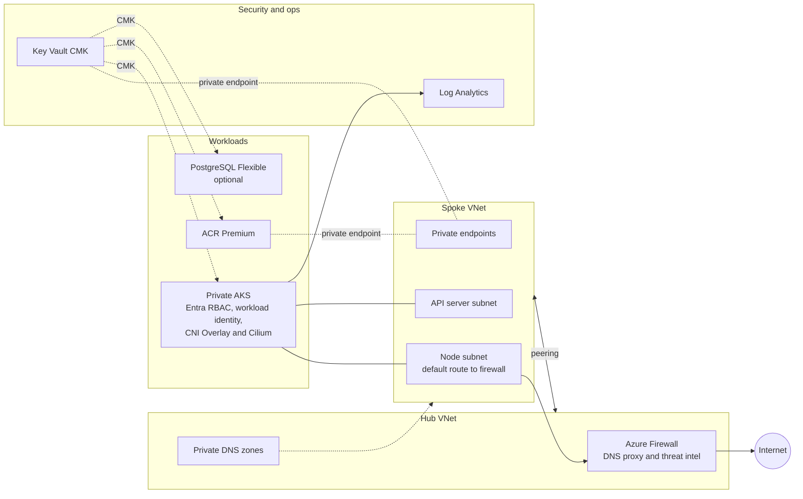
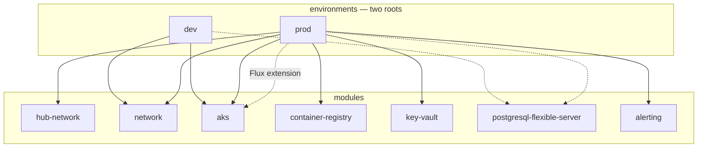
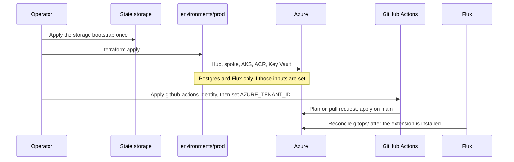

## Summary

A **Terraform reference platform for Azure Kubernetes Service (AKS)** shows how a production-shaped Kubernetes estate is **provisioned, networked, and handed off to GitOps on Azure** — with emphasis on the [AKS baseline](https://learn.microsoft.com/azure/architecture/reference-architectures/containers/aks/baseline-aks), **hub-and-spoke egress through Azure Firewall**, **private endpoints**, and **customer-managed keys** where compliance needs them.

The work centres on **platform engineering on Azure**: small first-party modules (network, cluster, registry, keys, database, alerting) composed into **`dev`** and **`prod`** roots, plus **bootstrap** for remote state and **GitHub Actions OIDC**. In-cluster software lives in **`gitops/`** and is reconciled by **Flux**, not by a Kubernetes provider in the same apply as the cluster.

It is the **Azure sibling** of [aws-eks-reference-platform](https://github.com/Tycho-1/aws-eks-reference-platform) and [gcp-gke-reference-platform](https://github.com/Tycho-1/gcp-gke-reference-platform): same portfolio story (modules + environments, secure defaults, GitOps boundary, honest scope), different cloud primitives. Azure Firewall and private DNS sit in the hub. The cluster uses **AKS-managed Cilium (CNI Overlay)** and the **cluster autoscaler**, not self-managed Cilium or Karpenter.

## Overview

| | |
| --- | --- |
| **Platform** | AKS on Azure — **dev**: single VNet, NAT egress, public API; **prod**: hub/spoke, Azure Firewall egress, private API |
| **IaC** | Terraform ≥ 1.11.1, **azurerm** 5.x — first-party modules under `modules/` (no provider blocks inside modules) |
| **Environments** | **`environments/dev`** and **`environments/prod`** — separate state (`dev.tfstate` / `prod.tfstate`) |
| **GitOps** | **Flux** (optional AKS extension) and `gitops/` in this repo; sample workload with workload identity and network policies |
| **CI** | `terraform.yml` on **1.11.1** and **latest** (mocked plan, no Azure login). `deploy-production.yml` plans and applies with **OIDC** once the tenant variable is set; it skips until then |
| **Focus of this work** | Baseline topology, module boundaries, Entra-only auth, CMK in prod, alerting, ADRs, quality gates |
| **Default region** | Code defaults are **westeurope**, Kubernetes **1.37**. The committed prod example is the smoke test: **northeurope**, **1.36**, zone **2** |
| **Status** | Dev applied and destroyed (2026-10-23). Prod smoke applied and destroyed (2026-10-30, 102 resources, PostgreSQL and Flux off). Reference implementation — verify in your subscription before production use. |

## Context

Teams adopting AKS often mix landing-zone networking, the cluster, and Helm in one root. Platform teams usually want:

- **Lifecycle-separated modules** (network, cluster, registry, keys, Postgres) so a cluster rebuild does not drag the registry or the database
- **Controlled egress** in production (Firewall and the AKS FQDN tag), not default outbound
- **Private-by-default** data plane: ACR, Key Vault, Postgres, and in prod the cluster API
- **Identity over secrets** — Entra groups for people, workload identity for apps, local accounts and storage keys off
- **Terraform stops at the cluster boundary** — Flux owns day-2 in-cluster config

On **AWS**, the sister repo self-manages **Cilium** and **Karpenter**. On **GCP**, **Dataplane V2** and the cluster autoscaler are Google-managed. On **Azure**, AKS already runs **Cilium as CNI Overlay** and scales explicit node pools. This repo does not install Cilium or Karpenter. The prod smoke test used a **Spot** `apps` pool (`Standard_D2s_v3` in North Europe). Dev uses a **Regular** `Standard_D2s_v3` `apps` pool; an earlier dev attempt on **B2s** Spot had no capacity.

## What was done

### Repository layout

| Layer | Path | Role |
| --- | --- | --- |
| **Modules** | `modules/` | Reusable Azure building blocks. Callers configure providers |
| **Environments** | `environments/dev`, `environments/prod` | Deployable roots. Separate backend key per folder |
| **Bootstrap** | `bootstrap/github-actions-identity`, `modules/storage-backend/examples/bootstrap` | One-off OIDC identities and the state storage account |
| **GitOps** | `gitops/` | Flux manifests (cert-manager, sample API). Not applied by the environment Terraform |
| **Decisions** | `docs/adr/` | Hub/spoke, CMK opt-in, OIDC, module split |
| **Runbooks** | `docs/runbooks/` | Index only. Upgrades, restore, key rotation, and break-glass are listed, not written |

### Internal modules

These modules call `azurerm` directly. The AWS and GCP sisters wrap `terraform-aws-modules` and `terraform-google-modules` because those are the standard cluster modules. On Azure the equivalent is [Azure Verified Modules](https://azure.github.io/Azure-Verified-Modules/). This repo follows that split — one capability per module, [ADR 0001](https://github.com/Tycho-1/az-aks-reference-platform/blob/main/docs/adr/0001-separate-modules-by-lifecycle.md) — and does not call the published modules, so each default is visible in the code. A platform team would usually start from AVM instead.

| Module | Purpose |
| --- | --- |
| **hub-network** | Hub VNet, Azure Firewall and policy, central private DNS, optional Bastion, optional point-to-site VPN (off unless `vpn_gateway` is set) |
| **network** | Spoke or standalone VNet, NSG per subnet, NAT or a firewall route, hub peering |
| **aks** | Public or private API, Entra RBAC, workload identity, monitoring, optional Flux, optional CMK for disk and etcd |
| **container-registry** | Premium ACR, private endpoint, Entra-only, optional CMK |
| **key-vault** | RBAC Key Vault, purge protection, rotating HSM keys |
| **postgresql-flexible-server** | Private Postgres, Entra auth, HA, optional CMK |
| **storage-backend** | Entra-only, versioned state storage |
| **alerting** | Metric and activity alerts, plus a budget. Wired in prod |
| **entra-app-registration** | App registration with a federated credential or a rotating secret |

**Keycloak** (`modules/keycloak`) is not part of the Azure platform. It configures a realm for applications that need their own login. It may move to its own repository.

### Environments

| Root | Topology | Tested |
| --- | --- | --- |
| **dev** | Single VNet, **NAT** egress, **public** API limited to authorized IPs, Regular `apps` pool, Postgres off unless `postgres_enabled` | Yes — North Europe, 2026-10-23, then destroyed. `kubectl` worked after kubelogin and **Azure Kubernetes Service RBAC Cluster Admin** |
| **prod** | **Hub + spoke**, **Firewall** egress, **private** cluster, private ACR and Key Vault, **CMK**, alerting. Postgres is on by default and off in the committed smoke-test example. Flux turns on only when `gitops_repository_url` is set | Smoke test — North Europe, 2026-10-30, **102** resources, then destroyed. PostgreSQL and Flux were off. Laptop `kubectl` did not resolve the private API |

Resource groups are split by lifecycle (`network`, `aks`, `data`, `security`, `ops`, `connectivity`).

The prod variable defaults are the larger West Europe layout. The firewall stays non-zonal there too, because `zones = []` is set in `environments/prod/network.tf`, not in tfvars. `environments/prod/terraform.tfvars.example` is the smaller smoke test. Copy it and replace the placeholder Entra group and the documentation IP before a real apply.

### Networking and egress

- **Prod hub** `10.0.0.0/22`: firewall subnet, optional Bastion, optional GatewaySubnet. Central private DNS for ACR, Key Vault, AKS, and Postgres. Spokes resolve those zones through the firewall DNS proxy.
- **Prod spoke** `10.10.0.0/16`: node subnet default route `0.0.0.0/0` to the firewall, delegated API-server subnet, optional Postgres subnet, private-endpoint subnet.
- **Firewall** allow-lists the AKS FQDN tag and denies with threat intel. The committed prod root sets `zones = []` because North Europe rejected a zonal Standard firewall. The module default remains zonal.
- **Dev** has no hub. Egress is a NAT gateway. The API is public and restricted to authorized IPs, including the NAT address so nodes can reach it.
- **Point-to-site VPN** on the hub is opt-in (`vpn_gateway_enabled`, default false). It was added after the smoke test and was not applied. It does not publish hub private DNS to the laptop, so `kubectl` still needs a resolver.

### Identity and data plane

- Cluster access is **Entra ID** with Azure RBAC. Local accounts are off. An Entra group is the admin; membership alone is not enough — the group or user also needs **Azure Kubernetes Service RBAC Cluster Admin**.
- Apps use **workload identity**. The sample API in `gitops/` is the pattern.
- **Prod** encrypts disk, etcd, ACR, and Postgres with **customer-managed keys** in Key Vault. **Dev** does not, so a sandbox does not pay for Premium Key Vault.
- ACR, Key Vault, and Postgres have **no public endpoint** in the prod layout. Postgres auth is Entra-only unless password auth is turned on explicitly.

### Node scaling

- System pool is Regular. The `apps` pool has min and max and the cluster autoscaler.
- Dev uses a Regular `Standard_D2s_v3` apps pool. Spot on that size works (the prod smoke test used it), but a Spot apps pool is tainted `kubernetes.azure.com/scalesetpriority=spot:NoSchedule`, so pods need that toleration. The system pool stays Regular because AKS does not allow Spot there.

### Flux GitOps

- The prod root can install the AKS Flux extension when `gitops_repository_url` is set. The committed example leaves it null, so Flux stays off.
- `gitops/` holds the Flux tree (controllers and a sample API). A separate workflow, `gitops.yml`, runs `kustomize build` and kubeconform. It does not apply Azure and does not need a cluster.
- Day-2 sync of that tree onto a live cluster has not been done. A later step is a fleet repository of its own, the same split the AWS and GCP pages describe.

### Remote state and CI

- State backend is Azure Storage with Entra auth. The storage-account bootstrap is a one-off example. Both live runs used a **local** state file.
- `terraform.yml` checks every module and both environments on Terraform **1.11.1** and on **latest**: fmt, validate, mocked `terraform test`, tflint, terraform-docs, Trivy. No Azure credentials. Green as of 2026-10-31. `1.11.0` is excluded because it cannot encode a sensitive write-only attribute.
- `deploy-production.yml` plans on pull requests and applies on `main` after an environment approval, using OIDC to the identities in `bootstrap/github-actions-identity`. Both jobs **skip while the repository variable `AZURE_TENANT_ID` is empty**. Leave it empty until that bootstrap is applied and the subscription, state storage, client IDs, and `TFVARS_PRODUCTION` secret are set. A private Key Vault needs a self-hosted runner (`TERRAFORM_RUNNER`); hosted runners cannot read the key data plane.

### What is intentionally not claimed

- A standing production estate. Both applies were destroyed the same day.
- Laptop `kubectl` to the private API. The name `privatelink.northeurope.azmk8s.io` did not resolve. VPN is optional and still needs private DNS.
- Flux sync, the OIDC apply, and remote state against this subscription.
- The four runbooks. The folder is a list.
- Keycloak as part of the Azure platform.

## Design rationale

| Area                         | Decision                                          | Rationale                                                                                                |
| ---------------------------- | ------------------------------------------------- | -------------------------------------------------------------------------------------------------------- |
| **Modules**                  | First-party, one concern each                     | Registry and database outlive a cluster rebuild. Callers own providers and names                         |
| **Module code** | Own `azurerm` resources, AVM-shaped split | Azure Verified Modules are the maintained base and the better starting point for a real platform. This reference writes the resources so private endpoints, Entra-only auth, and CMK are readable in the module. |
| **Prod egress**              | Spoke route to **Azure Firewall**                 | Allow-list the AKS FQDN tag. Deny by default with threat intel                                           |
| **Dev egress**               | **NAT gateway**, public API                       | A sandbox without a hub. Authorized IPs replace a private API                                            |
| **CMK**                      | On in the prod layout, off in dev                 | Compliance versus cost. Relaxing a default is an explicit input                                          |
| **Dataplane**                | AKS **CNI Overlay + Cilium**                      | Microsoft operates the CNI. The EKS repo installs Cilium because the default VPC CNI path is different   |
| **Node scaling**             | Pool min/max and the cluster autoscaler           | No Karpenter on AKS in this repo. Same idea as the GKE sister                                            |
| **GitOps**                   | Flux extension optional; manifests in `gitops/`   | Terraform does not own the app. The check workflow does not assume a cluster exists                      |
| **CI auth**                  | OIDC, plan and apply identities                   | No long-lived Azure secret in GitHub. The tenant variable is the switch until bootstrap exists           |
| **Firewall zones**           | Module default zonal; this prod root `zones = []` | North Europe rejected Standard firewall zones 1–3. The tested layout stays non-zonal                     |

## Architecture

### Platform stack (prod)

Dev is not a smaller copy of this diagram. It is one VNet, a NAT gateway, and a public API. There is no hub, firewall, Key Vault, or registry.

### Terraform composition

Solid lines are wired in the prod root. Dashed lines are off unless the input is set.

How to read it: `cd` into `environments/dev` or `environments/prod` and apply that root. Dev calls `network` and `aks`, and calls Postgres only when `postgres_enabled` is true. Prod always calls the hub, the spoke, AKS, ACR, Key Vault, and alerting. Postgres and the Flux extension follow their own inputs. The smoke-test example turns Postgres and Flux off.

### Bootstrap sequence

The two live runs skipped the state account and the GitHub identity and used local state. Destroy removed the estate the same day. A Key Vault with purge protection cannot be purged after destroy; the next apply uses a new name.

## Technology stack

| Layer | Technologies |
| --- | --- |
| **Cloud** | AKS, Virtual Network, Azure Firewall, NAT Gateway, Bastion, Private DNS, ACR, Key Vault, PostgreSQL Flexible Server, Log Analytics, Azure Monitor |
| **IaC** | Terraform ≥ 1.11.1, azurerm ≥ 5 and &lt; 6, azuread 3 |
| **Networking** | Hub/spoke or a single VNet. CNI Overlay, Cilium dataplane and network policy, private endpoints in prod |
| **Autoscaling** | Cluster autoscaler on the `apps` pool. Spot is optional |
| **GitOps** | Flux (AKS extension, off until a Git URL is set). `gitops/` checked with kustomize and kubeconform |
| **Identity** | Entra ID, Azure RBAC for Kubernetes, workload identity. OIDC for GitHub Actions |
| **Secrets and keys** | Key Vault RBAC, purge protection, customer-managed keys in the prod layout |
| **CI** | fmt, validate, terraform test, tflint, terraform-docs, Trivy, actionlint. Production plan and apply pinned to Terraform 1.11.1 |

## Design principles

1. **Secure by default.** No public data-plane endpoint, Entra-only, local accounts off. A sandbox relaxes that with an explicit input, as dev does for the API and for CMK.
2. **Modules are a library, environments are roots.** One module, two deployment shapes. Names and providers stay with the caller.
3. **Plan-time conditions only.** `count` and `for_each` depend on inputs known at plan time, not on resource IDs that appear during apply.
4. **Platform versus application.** Terraform builds Azure. Flux reconciles what runs on the cluster.
5. **Honest pairing with the other clouds.** Same story as the EKS and GKE repos, without pretending AKS needs a self-managed Cilium or Karpenter install.
6. **Record what was actually applied.** The prod example is the smoke test. The larger West Europe layout stays in the variable defaults and in comments.

## Relation to other work

| Project | Role |
| --- | --- |
| [aws-eks-reference-platform](https://github.com/Tycho-1/aws-eks-reference-platform) | AWS sister — Cilium, Karpenter, optional Flux |
| [gcp-gke-reference-platform](https://github.com/Tycho-1/gcp-gke-reference-platform) | GCP sister — Dataplane V2, layered state, Flux or Argo CD |
| [tiho-banking-platform](https://github.com/Tycho-1/tiho-banking-platform) | Application layer — Kustomize overlays that can run on a cluster bootstrapped here |

A realistic end-to-end story: Terraform provisions AKS (this repo) → Flux reconciles platform and app manifests → an application overlay runs on the cluster. The Flux half of that story has not been run against a live cluster yet.

## Sister repos

| | AWS (EKS) | GCP (GKE) | Azure (this repo) |
| --- | --- | --- | --- |
| **Cluster** | EKS | GKE Standard, regional | AKS, private in prod |
| **CNI / dataplane** | Cilium (Helm), kube-proxy replacement | Dataplane V2 | AKS CNI Overlay + Cilium |
| **Node scaling** | Karpenter and a system node group | Cluster autoscaler on one pool | Cluster autoscaler, system pool plus `apps` |
| **Environments** | `cilium-karpenter` (tested), `default` (reference) | `dev` / `prod` × foundation / platform layers | `dev` / `prod` roots |
| **GitOps** | Flux optional in the Cilium env | Flux layer, or Argo CD as an example | Flux extension optional; `gitops/` in-repo |
| **Data** | Optional RDS module | Not in the repo yet | PostgreSQL Flexible Server, optional |
| **Keys** | Not the focus | Not the focus | Key Vault CMK in the prod layout |
| **Bootstrap pain** | Cilium before nodes, CoreDNS API access | Terraform provider order, so two state layers | Private API and private Key Vault: DNS, and a runner inside the network |
| **Modules** | Wrap `terraform-aws-modules` | Wrap `terraform-google-modules` | Own `azurerm` resources, split like Azure Verified Modules |

## Cost (lab)

Azure Firewall bills for every hour it exists, including after the cluster is quiet. Zone-redundant PostgreSQL and Premium ACR and Key Vault dominate the rest of a full prod apply. The 2026-10-30 smoke test left PostgreSQL off, used a small Spot pool, and was destroyed the same day so the firewall would not keep billing. Dev is the cheap shape: NAT, no firewall, no Key Vault.

## Attribution and license

Infrastructure code and documentation: [Tycho-1/az-aks-reference-platform](https://github.com/Tycho-1/az-aks-reference-platform), MIT. Modules are first-party Terraform on the azurerm provider. Flux is the upstream project, installed only when the GitOps input is set.
