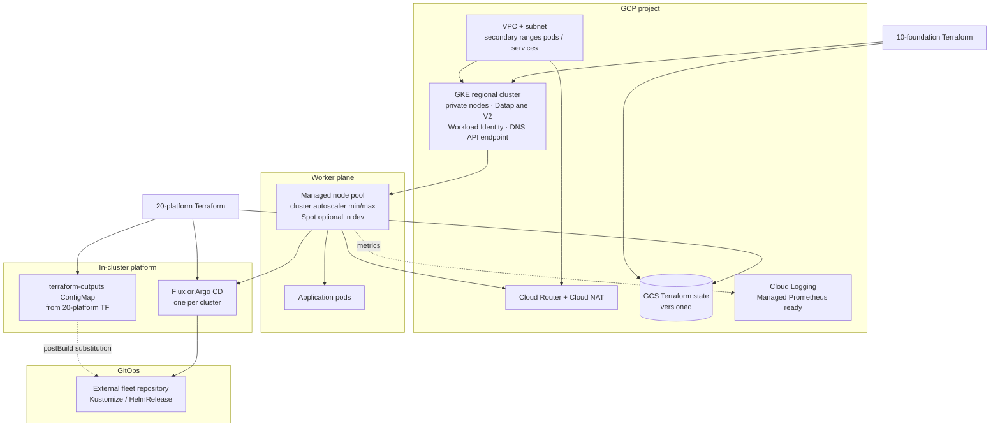
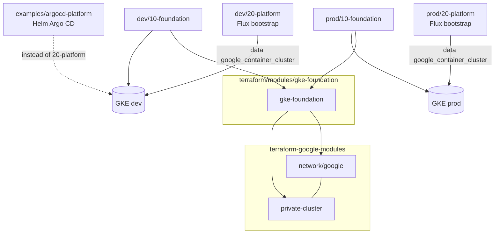
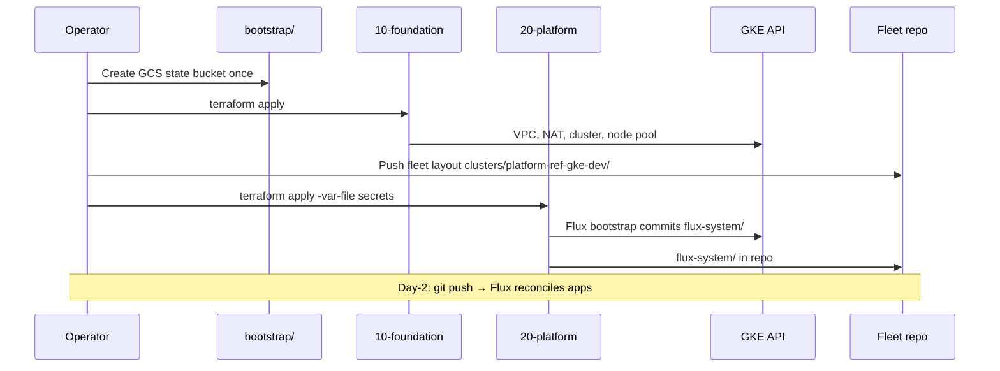

## Summary

A **Terraform reference platform for Google Kubernetes Engine (GKE)** demonstrates how a production-shaped Kubernetes cluster is **provisioned, networked, and handed off to GitOps on GCP** — with emphasis on **secure-by-default GKE**, **VPC-native networking**, and **explicit Terraform layering**.

The work centres on **platform engineering on Google Cloud**: wrapping **terraform-google-modules** (Google-maintained community modules) with opinionated defaults, solving the **provider bootstrap ordering** problem (foundation vs platform state), and leaving a clear path for **Flux- or Argo CD–driven** workloads in a separate fleet repository. It is designed to pair with application repos (for example a Kustomize-based microservice estate on Flux) that consume a cluster bootstrapped from this platform.

It is the **GCP sibling** of [aws-eks-reference-platform](https://github.com/Tycho-1/aws-eks-reference-platform): same portfolio narrative (module + environments, GitOps bootstrap, honest scope), different cloud primitives (Dataplane V2 and cluster autoscaler instead of self-managed Cilium and Karpenter).

---

## Overview

| | |
| --- | --- |
| **Platform** | GKE Standard on GCP (dedicated VPC, Cloud NAT, optional multi-project isolation per env) |
| **IaC** | Terraform — internal **`gke-foundation`** module wrapping **terraform-google-modules/network** and **kubernetes-engine/private-cluster** |
| **Primary environments** | **`dev`** and **`prod`** — each split into **`10-foundation`** (GCP only) and **`20-platform`** (Flux bootstrap), **separate GCS state** |
| **GitOps** | **Flux** (`environments/<env>/20-platform`) — primary |
| **GitOps alternative** | **Argo CD** via Helm in **`examples/argocd-platform`** — same cluster lookup pattern |
| **Focus of this work** | Cluster baseline, security defaults, state/layer design, Flux bootstrap, CI quality gates, ADRs |
| **Default region** | **europe-west1** |
| **Status** | **`dev`** layer split **verified** apply + destroy (**2026-10-08**); **Demonstration** — verify before apply. |

---

## Context

Teams adopting GKE often start with the console or a single Terraform file that mixes VPC, cluster, and in-cluster Helm. That works for a workshop, but platform teams usually want:

- **Reusable modules** with a stable contract (`name`, `environment`, CIDRs, one managed node pool)
- **Lifecycle environments** (`dev` / `prod`) whose differences are **code-reviewed literals**, not hidden tfvars
- **Secure defaults** that survive copy-paste (private nodes, Dataplane V2, Workload Identity; no default `0.0.0.0/0` on the IP API endpoint)
- **GitOps** (Flux or Argo CD) reconciling platform add-ons and apps **after** Terraform creates the cluster
- **Separate blast radius** between slow GCP applies and fast in-cluster bootstrap

On AWS, the sister repo encodes the **“modern platform”** path: Cilium, Karpenter, optional Flux, and explicit bootstrap ordering. On GCP, Google already ships **Dataplane V2** (eBPF, Cilium-based) and **managed node pool autoscaling** — so this repository **does not** self-install Cilium or Karpenter. Instead it documents **when to use Google’s managed dataplane** and **cluster autoscaler**, and keeps Terraform focused on **GCP-only** foundation code ([ADR 0004](https://github.com/Tycho-1/gcp-gke-reference-platform/blob/main/docs/adr/0004-cluster-autoscaler-not-karpenter.md)).

This repository captures a **structured Terraform layout** (module + environments + layers) aligned with [Google’s Terraform on GCP guidance](https://cloud.google.com/docs/terraform/best-practices/general-style-structure), plus the **layer split** required so `kubernetes` / `flux` providers never plan against a cluster that does not exist yet ([ADR 0007](https://github.com/Tycho-1/gcp-gke-reference-platform/blob/main/docs/adr/0007-lifecycle-environments-and-layers.md)).

It complements an application-focused project (portable Kubernetes manifests and overlays) by owning **how the GKE cluster and VPC are built**.

---

## What was done

### Repository layout

| Layer | Path | Role |
| --- | --- | --- |
| **Modules** | `terraform/modules/` | Reusable building blocks |
| **Bootstrap** | `terraform/bootstrap/` | One-time **GCS state bucket** per GCP project |
| **Environments** | `terraform/environments/{dev,prod}/` | Root modules — **two layers each**, separate state prefix |
| **Fleet templates** | `examples/flux-fleet-sample/` | Layout for a **separate Git repo** (day-2 `git push`) |
| **Argo alternative** | `examples/argocd-platform/` | Separate Terraform root (own GCS prefix) — use **instead of** `20-platform` on that cluster |
| **Decisions** | `docs/adr/` | Non-obvious choices recorded (security, layers, state, GitOps) |

### Internal module

| Module | Wraps (community) | Purpose |
| --- | --- | --- |
| **gke-foundation** | `terraform-google-modules/network/google` **18.2.0**, `terraform-google-modules/kubernetes-engine/google//modules/private-cluster` **45.0.0** | Project APIs (optional), dedicated VPC + **Alias IP** secondary ranges, **Cloud Router + Cloud NAT**, **regional private GKE**, single **managed node pool** with min/max (cluster autoscaler), plan-time **`check`** blocks |

The inner modules are **Google-maintained** (`terraform-google-modules`) — the de facto standard for VPC + GKE in Terraform, similar in spirit to **terraform-aws-modules** on AWS. The outer module is a **small, stable façade**: naming, CIDRs, security defaults, one pool, pinned upstream versions.

**Module contract:** **GCP providers only** — no Helm, Kubernetes, or Flux inside `gke-foundation` ([ADR 0001](https://github.com/Tycho-1/gcp-gke-reference-platform/blob/main/docs/adr/0001-module-and-environment-split.md)).

### Environments and layers

Environments are **lifecycle stages** (`dev`, `prod`), not GitOps tool names. Each stage has **two Terraform roots**:

| Layer | Owns | Providers | State prefix (example) |
| --- | --- | --- | --- |
| **10-foundation** | APIs, VPC, NAT, GKE, node pool | `google`, `google-beta` | `dev/10-foundation` |
| **20-platform** | Flux bootstrap, `terraform-outputs` ConfigMap | `google` (data), `kubernetes`, `flux` | `dev/20-platform` |

**Why layers?** Terraform configures providers **before** creating resources. A single root cannot reliably wire `kubernetes` / `flux` from a cluster it is still creating — that forced `-target` on first apply. With two roots, the cluster **already exists** when `20-platform` plans. A Flux mistake cannot plan changes to the VPC or cluster.

| Environment | Cluster name | Node profile (high level) | Tested |
| --- | --- | --- | --- |
| **dev** | `platform-ref-gke-dev` | Spot `e2-standard-4`, **0–3** per zone, `deletion_protection = false` | **Yes**  |
| **prod** | `platform-ref-gke-prod` | On-demand, **1–5** per zone, multi-zone, `deletion_protection = true`, Flux **NetworkPolicies** on | Code parity with dev; full prod apply optional |

Security-sensitive settings are **identical** in both tiers ([ADR 0006](https://github.com/Tycho-1/gcp-gke-reference-platform/blob/main/docs/adr/0006-secure-by-default-gke.md)); only **cost and lifecycle** knobs differ (Spot, zones, deletion protection).

Environment opinions (CIDRs, sizing, Spot, zones) are **literals** in `10-foundation/main.tf`. Variables are for per-user values: `project_id`, `region`, `master_authorized_networks` (in `10-foundation`; may be `[]` if you rely on the DNS endpoint only), optional `cluster_zones` in **dev** `10-foundation`, plus Git URL and secrets in `20-platform`.

### Networking and GKE dataplane

- **Dedicated VPC** per environment naming (`{name}-{environment}`), not the default VPC.
- **VPC-native GKE**: primary subnet for nodes; secondary ranges **`ip-range-pods`** and **`ip-range-svc`** for pods and ClusterIP services.
- **Private nodes** with **Private Google Access**; **Cloud NAT** for general internet egress from private nodes.
- **Dataplane V2** (`ADVANCED_DATAPATH`) — Google-managed eBPF datapath with **native NetworkPolicy** enforcement and policy logging; legacy Calico add-on explicitly rejected via `check` blocks.
- **Regional** control plane and nodes across zones (configurable; dev can pin a single zone for cost).
- **Release channel** `REGULAR` with `kubernetes_version = "latest"` — channel owns upgrades; maintenance windows control timing.

### Secure-by-default control plane access

| Mechanism | Role |
| --- | --- |
| **`master_authorized_networks`** | Set in `10-foundation` tfvars (variable has no default — you must pass it, including `[]`). Plan **warns** on `0.0.0.0/0`. First line of defence for the **IP** API endpoint. |
| **DNS-based control plane endpoint** (default on) | **IAM** authorizes every request; `gcloud … get-credentials --dns-endpoint` from laptops or CI without widening IP allowlists. |
| **Shielded nodes**, **security posture BASIC**, dedicated **node service account** | Reduce node tampering and surface misconfiguration early. |
| **Workload Identity pool** enabled | Pods can call GCP APIs without JSON keys; per-app IAM bindings planned in fleet or env TF (P1). |

### Node scaling (cluster autoscaler + VPA)

- **Single managed node pool** with `min_node_count` / `max_node_count` — GKE **cluster autoscaler** scales node count on **scheduling pressure** (Pending pods), not a separate Helm chart.
- **GKE-managed VPA** enabled at cluster level; **`VerticalPodAutoscaler`** CRs belong in the fleet repo.
- **No Karpenter on GKE** in this repo — intentional ([ADR 0004](https://github.com/Tycho-1/gcp-gke-reference-platform/blob/main/docs/adr/0004-cluster-autoscaler-not-karpenter.md)); sister EKS repo uses Karpenter where AWS patterns differ.

### Flux GitOps (primary platform layer)

- Bootstrap via **Terraform Flux provider** in `environments/<env>/20-platform` (`flux_bootstrap_git`).
- **`terraform-outputs` ConfigMap** in `flux-system` — cluster name, location, GCP project, region, environment for fleet **postBuild substitution**.
- Connects to the cluster through the **DNS endpoint** by default (publicly trusted cert; works from CI without control-plane IP allowlisting).
- **PAT or SSH** deploy-key auth; secrets in `terraform.tfvars.secrets` (not committed).
- After bootstrap, **platform add-ons and apps** live in the **fleet repo** (`examples/flux-fleet-sample` is the template).

### Argo CD (alternative platform layer)

- **`examples/argocd-platform/`** — separate root with its own **`backend.tf`** prefix (sample: `dev/20-platform-argocd`); same `data "google_container_cluster"` + Kubernetes/Helm provider pattern as `20-platform`.
- Installs **Argo CD** with pinned Helm chart and hardened values (TLS, limits, Dex/exec off).
- Optional **`Application`** CR for commit-to-deploy demo.
- **One GitOps tool per cluster** — do not apply Flux `20-platform` and Argo on the same cluster ([ADR 0003](https://github.com/Tycho-1/gcp-gke-reference-platform/blob/main/docs/adr/0003-one-gitops-tool-per-cluster.md)).

### Remote state and CI

- **GCS backend** — `terraform/bootstrap/` creates the versioned bucket (bootstrap stack uses **local state** once); env layers and `argocd-platform` each have `backend.tf` with their own **prefix** ([ADR 0005](https://github.com/Tycho-1/gcp-gke-reference-platform/blob/main/docs/adr/0005-terraform-state-in-gcs.md)).
- **CI on every PR** (`.github/workflows/ci.yml`): `terraform fmt` + `validate` all roots, **tflint** (Google ruleset), **Trivy** IaC (HIGH/CRITICAL) + secret scan, **kubeconform** on example manifests; **Dependabot** for Actions and Terraform lockfiles.
- **Terraform plan in CI** not enabled by default (no GCP credentials in GHA) — planned via WIF (P3).

### What is intentionally not in foundation Terraform

- Application Deployments, ingress controllers, cert-manager, ESO, HPA demos — **fleet GitOps** or future P1–P2 work (`platform-requirements.md`, `todolist.md`).
- **GKE Autopilot** — Standard cluster with explicit node pool ([ADR 0002](https://github.com/Tycho-1/gcp-gke-reference-platform/blob/main/docs/adr/0002-gke-standard-over-autopilot.md)).
- **Artifact Registry**, **Workload Identity Federation for GitHub Actions** — roadmap P1/P3.

---

## Design rationale

| Area | Decision | Rationale |
| --- | --- | --- |
| **GKE base** | Community **terraform-google-modules** (network + private-cluster) | Battle-tested VPC-native GKE wiring; avoid maintaining a fork of Compute + Container resources. |
| **Dataplane** | **Dataplane V2** (managed), not self-managed Cilium Helm | Google operates the eBPF dataplane; NetworkPolicy without operating a CNI release. AWS sister repo self-manages Cilium because EKS default CNI path differs. |
| **Node scaling** | **Managed node pool** + min/max | Native cluster autoscaler; no third-party provisioner on GKE. |
| **Module vs platform** | **GCP-only module** + **`20-platform` root** | Reusable foundation; Kubernetes providers have different lifecycle and credentials ([`terraform/ARCHITECTURE.md`](https://github.com/Tycho-1/gcp-gke-reference-platform/blob/main/terraform/ARCHITECTURE.md) §5.4). |
| **Environments** | **`dev` / `prod` folders**, not tool-named roots | Lifecycle stages; GitOps tool is a layer choice (Flux default, Argo example). |
| **State** | **One prefix per env × layer** | `dev` apply cannot touch `prod`; Flux plans cannot touch VPC. |
| **Security defaults** | On in every tier; Spot/zones/deletion protection explicit in dev | Reference code gets copied — insecure defaults propagate ([ADR 0006](https://github.com/Tycho-1/gcp-gke-reference-platform/blob/main/docs/adr/0006-secure-by-default-gke.md)). |
| **Flux bootstrap in Terraform** | One-shot install; fleet repo owns ongoing state | Same pattern as EKS repo: platform repo creates cluster + GitOps entry; apps live elsewhere. |
| **Argo as example** | Not a second env folder | Avoid implying two “environments” that differ only by CD tool; keeps **one GitOps tool per cluster** obvious. |
| **Examples vs monorepo** | `flux-fleet-sample` is a **template repo** | Day-2 is `git push`; keeps application blast radius out of platform Terraform. |

---

## Architecture

### Platform stack (dev / prod)

### Terraform composition

Solid = `module` or `data` wiring today. Dashed = **pick one** GitOps root per cluster (`20-platform` **or** `argocd-platform`, not both).

**How to read it:** Only **`10-foundation`** calls `gke-foundation`. **`20-platform`** (and the Argo example) **look up** an existing cluster — they do not create VPC or GKE. Apply **`10` → `20`** (or Argo instead of `20`); destroy in reverse.

### Bootstrap sequence (why order matters)

Unlike the EKS **Cilium → nodes → CoreDNS** chain, GKE brings a **managed dataplane** online with the cluster; the hard ordering problem here is **Terraform provider configuration**, solved by **splitting state**, not by `-target`.

---

## Technology stack

| Layer | Technologies |
| --- | --- |
| **Cloud** | GKE Standard, VPC, Cloud NAT, IAM, Cloud Logging, Managed Service for Prometheus (collection ready) |
| **IaC** | Terraform ≥ 1.5; **terraform-google-modules** network **18.2.0**, private-cluster **45.0.0** |
| **Networking / policy** | VPC-native Alias IPs, **Dataplane V2**, Kubernetes NetworkPolicy |
| **Autoscaling** | GKE cluster autoscaler (node pool min/max); GKE-managed **VPA**; HPA in fleet (planned demo) |
| **GitOps** | **Flux v2** — Terraform `flux_bootstrap_git`; fleet template in `examples/flux-fleet-sample` |
| **Alternative CD** | **Argo CD** — Helm in `examples/argocd-platform` |
| **Identity** | Workload Identity pool; node dedicated GCP service account |
| **Secrets (bootstrap)** | `terraform.tfvars.secrets` for GitHub PAT / SSH — not in git |
| **CI** | fmt, validate, tflint, Trivy, kubeconform; pre-commit optional locally |

---

## Design principles

The project is structured around a small set of recurring ideas:

1. **Community modules as foundation** — GKE and VPC complexity lives upstream; internal module encodes **decisions and pins**, not a rewrite of GCP resources.
2. **Explicit layer graph** — foundation before platform; destroy in reverse; no `-target` gymnastics on first apply.
3. **Platform vs application split** — this repo bootstraps the cluster and GitOps; workloads and overlays live in **Git** (fleet) or separate application repositories.
4. **Secure by default** — private nodes, Dataplane V2, explicit control-plane access in tfvars (no default `0.0.0.0/0`), DNS endpoint for IAM; lab trade-offs (Spot, single zone) are **explicit** in env code.
5. **Honest cloud pairing** — symmetric **portfolio story** with the AWS sister repo, without pretending GKE needs the same Cilium/Karpenter install path as EKS.
6. **Document decisions** — ADRs for module split, Autopilot choice, autoscaler vs Karpenter, one GitOps tool, GCS state, layers, security defaults.

---

## Relation to other work

| Project | Role |
| --- | --- |
| **[aws-eks-reference-platform](https://github.com/Tycho-1/aws-eks-reference-platform)** | AWS cluster bootstrap — Cilium, Karpenter, Flux; **sister repo** for tycho-1.github.io symmetry |
| **[az-aks-reference-platform](https://github.com/Tycho-1/az-aks-reference-platform)** | **Azure sister repo** — AKS bootstrap (private-by-default prod, optional Flux) |
| **[tiho-banking-platform](https://github.com/Tycho-1/tiho-banking-platform)** | Application layer — Kustomize overlays, Bank of Anthos; can run on a cluster bootstrapped here (verified with external fleet on **2026-10-08**) |

A realistic end-to-end story: **Terraform provisions GKE (this repo)** → **Flux reconciles platform and app manifests (fleet repo)** → **banking-platform or other overlays run on the cluster**.

---

## AWS vs GCP sister repos (portfolio table)

| | AWS ([EKS](https://tycho-1.github.io/projects/aws-eks-reference-platform/)) | GCP (this repo) |
| --- | --- | --- |
| Cluster | EKS | GKE Standard, regional |
| CNI / dataplane | Cilium (Helm), kube-proxy replacement | **Dataplane V2** (Google-managed) |
| Node scaling | Karpenter + system node group | **Cluster autoscaler** on managed pool |
| Environments | `cilium-karpenter` (tested), `default` (reference) | **`dev` / `prod`** × **`10` / `20` layers** |
| GitOps | Flux optional in cilium env | **Flux** (`20-platform`) or **Argo** (example) |
| Extra data plane | Optional RDS module | Not in repo yet (Secret Manager + ESO planned) |
| Bootstrap pain point | Cilium / CoreDNS / Flux API ordering on EKS | **Terraform provider** ordering → **layer split** |

---

## Follow-up work

Honest scope — not yet in the repository (see repo `todolist.md`):

- **Workload Identity Federation** — GitHub OIDC → GCP for `terraform plan` on PR and image push
- **Artifact Registry** + **per-app Workload Identity** bindings in Terraform
- **External Secrets Operator** + Secret Manager demo
- **cert-manager**, **Ingress / Gateway API**, sample Helm app, **HPA** load test
- **Kyverno** or GKE Policy Controller examples
- **Cloud CDN + global HTTP(S) load balancing** — edge story (compare with AWS ALB/CloudFront notes)
- **Module version pinning** via git tags for prod (`?ref=vX.Y.Z`)
- **Optional `staging`** env — folder copy of `prod` with non-overlapping CIDRs
- Portfolio **screenshot / short demo** clip in README (P0 polish)

---

## Cost (lab)

With the **`dev`** shape, README estimates **roughly €3–8 per day** (regional cluster management fee, 0–3 Spot `e2-standard-4` nodes, Cloud NAT). Destroy **`20-platform`** then **`10-foundation`** when idle — clusters cost money.

---

## Attribution and license

Infrastructure code and documentation: [Tycho-1/gcp-gke-reference-platform](https://github.com/Tycho-1/gcp-gke-reference-platform). Built on [terraform-google-modules](https://github.com/terraform-google-modules). Flux and Argo CD are upstream open-source projects installed via Terraform providers / Helm.

© Tihomir Nikolov